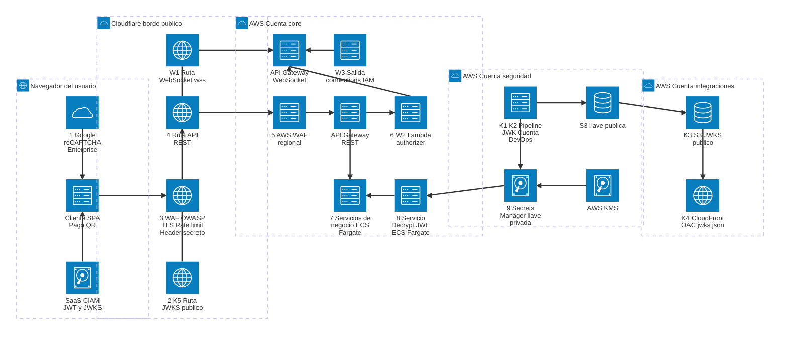
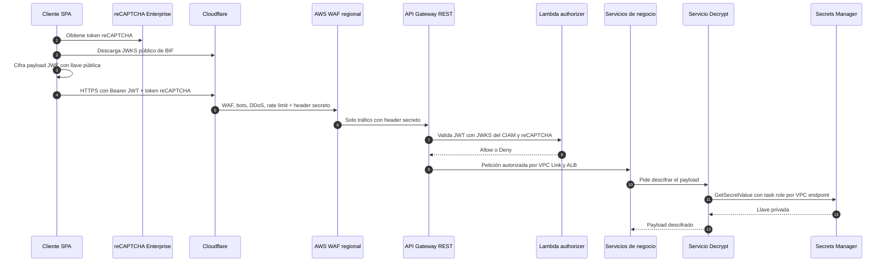
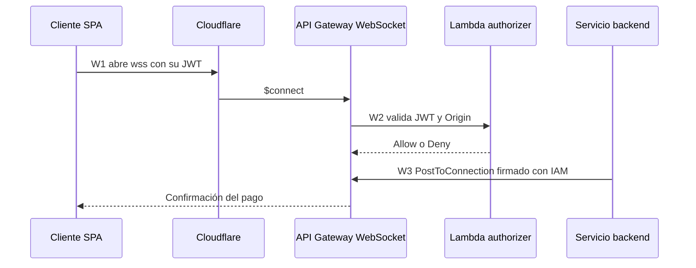

# Vista de seguridad · Pago de préstamos QR Red Externa

## Arquitectura

> Los números de cada ícono corresponden a los pasos de las secuencias de abajo. La validación del JWT (JWKS del CIAM) y del token reCAPTCHA en el Lambda authorizer, y la publicación K5 de CloudFront hacia Cloudflare, se detallan en las secuencias y la tabla.

## Secuencia de una petición

## Canal WebSocket · confirmación del pago

## Ciclo de las llaves JWK

| Paso | Descripción |
|------|-------------|
| K1 | El Pipeline JWK genera el par de llaves y guarda la llave privada en Secrets Manager, cifrada con KMS |
| K2 | Guarda la llave pública en el S3 de la cuenta de seguridad |
| K3 | La llave pública se sincroniza al S3 de la cuenta de integraciones |
| K4 | CloudFront la sirve desde S3 con OAC como JWKS público |
| K5 | Cloudflare publica el JWKS para que lo descargue el navegador |

> **Regla clave:** la llave privada nunca sale de Secrets Manager. Por Cloudflare solo se expone el JWKS público. Solo el task role del Servicio Decrypt puede leer la llave privada, y KMS la mantiene cifrada.
